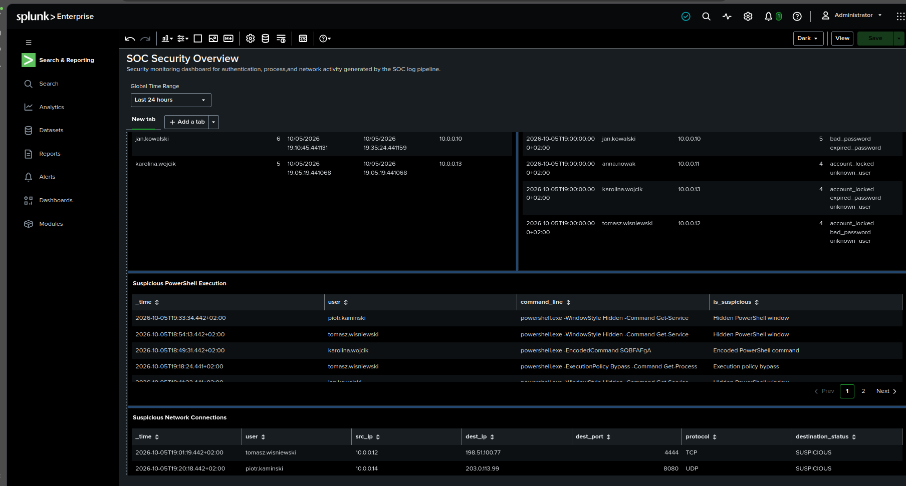

# SOC Log Pipeline — Python & Splunk

## Overview

This project is a small SOC monitoring lab that combines Python-based security event generation with Splunk detection and analysis.

A custom Python application generates synthetic authentication, process execution, and network connection events. The events are exported to JSON and ingested into Splunk, where SPL queries are used to identify suspicious activity.

The project demonstrates an end-to-end workflow:

**Python Event Generator → JSON Logs → Splunk → SPL Detections → Alerts → Dashboard → Investigation**

The goal of the project is to practice skills relevant to a Junior SOC Analyst role, including log analysis, detection engineering fundamentals, alert creation, event correlation, and investigation of suspicious activity.

---

## Architecture

```text
Python Security Event Generator
            |
            v
       JSON Logs
            |
            v
      Splunk Ingestion
            |
            v
       SPL Searches
            |
            v
   Security Detections
            |
      +-----+-----+
      |           |
      v           v
    Alerts     Dashboard
      |
      v
 SOC Investigation
```

---

## Technologies

- Python 3
- Splunk Enterprise
- SPL (Search Processing Language)
- JSON
- Git / GitHub
- MITRE ATT&CK

---

## Project Structure

```text
soc-log-pipeline/
|
├── main.py
├── generator.py
├── data_config.py
├── README.md
├── .gitignore
|
├── data/
│   └── logs.json
|
├── screenshots/
│   ├── brute-force-detection.png
│   ├── login-correlation.png
│   ├── suspicious-powershell.png
│   ├── suspicious-network.png
│   └── soc-dashboard.png
|
└── docs/
    └── SOC_Log_Pipeline_Splunk_Report.docx
```

---

## Python Event Generator

The Python component generates synthetic security telemetry representing activity in a small corporate environment.

The environment contains multiple users assigned to different workstations and departments.

Generated event types include:

### Authentication Events

- Successful logins
- Failed logins
- Failed authentication attempts originating from simulated attacker IP addresses
- Multiple authentication failure reasons

Example:

```json
{
    "timestamp": "2026-10-06T20:15:00+00:00",
    "event_type": "failed_login",
    "user": "jan.kowalski",
    "host": "FIN-PC-01",
    "src_ip": "203.0.113.50",
    "department": "Finance",
    "status": "failure",
    "failure_reason": "bad_password"
}
```

### Process Execution Events

The generator produces normal application execution as well as PowerShell activity.

Normal processes include applications such as:

- chrome.exe
- msedge.exe
- outlook.exe
- teams.exe
- excel.exe
- winword.exe

The dataset also contains normal and suspicious PowerShell commands.

Suspicious examples include behaviors such as:

- Execution Policy Bypass
- Hidden PowerShell windows
- Encoded PowerShell commands

### Network Connection Events

Network events contain information such as:

- source IP
- destination IP
- destination port
- protocol
- connection status

The generator creates both normal outbound connections and connections to predefined suspicious destinations.

---

## Splunk Detection Use Cases

The generated JSON dataset is ingested into Splunk and analyzed using SPL.

The lab contains several security detection use cases.

### 1. Brute Force Detection

Identifies multiple failed authentication attempts associated with a user and source IP within a defined time window.

The detection can be used to identify potential password guessing activity.

Investigation fields include:

- timestamp
- username
- source IP
- number of failed attempts
- authentication failure reasons

Potential false positives include repeated user password mistakes or applications using outdated credentials.

**MITRE ATT&CK:** T1110 — Brute Force

---

### 2. Successful Login After Multiple Failures

Correlates repeated failed authentication attempts with a later successful login.

This behavior may indicate that an attacker successfully obtained or guessed valid credentials after several unsuccessful attempts.

The detection is intended to provide higher-value context than monitoring failed authentication events alone.

Analyst investigation should include:

- source IP
- affected user
- affected host
- authentication timeline
- activity following the successful login

---

### 3. Suspicious PowerShell Execution

PowerShell process events are analyzed for suspicious command-line patterns.

The detection identifies behaviors such as:

```text
-ExecutionPolicy Bypass
-WindowStyle Hidden
-EncodedCommand
```

These patterns are not automatically malicious, but they can be useful indicators during an investigation when combined with additional context.

**MITRE ATT&CK:** T1059.001 — PowerShell

---

### 4. Suspicious Network Connections

Network telemetry is analyzed for connections to predefined suspicious destination IP addresses and unusual destination ports.

Investigation fields include:

- timestamp
- user
- source IP
- destination IP
- destination port
- protocol

The purpose of this detection is to identify potentially suspicious outbound communication that can be correlated with authentication and process execution events.

---

## Alerting

Two higher-priority authentication detections were selected as candidates for SOC alerting:

### Possible Brute Force Attack

Triggers when repeated failed authentication activity exceeds the configured detection threshold.

### Successful Login After Multiple Failures

Detects a successful authentication associated with preceding failed login activity.

These detections are intended to demonstrate the difference between general monitoring and activity that may require analyst investigation.

---

## SOC Security Dashboard

A Splunk dashboard was created to provide centralized visibility into the generated security telemetry and detection results.

The dashboard contains views for:

- brute-force activity
- failed authentication attempts by user
- suspicious PowerShell execution
- suspicious network connections
- authentication correlation



The dashboard combines high-level monitoring with detailed tables that can be used during investigation.

---

## Investigation Workflow

A SOC analyst can use the detections to investigate activity across multiple event types.

Example investigation flow:

```text
Multiple Failed Logins
          |
          v
   Source IP / User
          |
          v
 Successful Login?
          |
          v
 Process Execution
          |
          v
Suspicious PowerShell?
          |
          v
 Network Connection
          |
          v
Suspicious Destination?
          |
          v
 Analyst Decision
```

This allows authentication, endpoint process, and network telemetry to be correlated into a single investigation timeline.

---

## Running the Generator

Clone the repository:

```bash
git clone <repository-url>
cd soc-log-pipeline
```

Run the event generator:

```bash
python3 main.py
```

The generated events are written to:

```text
data/logs.json
```

The JSON dataset can then be ingested into Splunk for analysis.

---

## Skills Demonstrated

This project demonstrates practical experience with:

- Python scripting
- Synthetic security telemetry generation
- JSON log generation
- Splunk data ingestion
- SPL queries
- Authentication log analysis
- Brute-force detection
- Event correlation
- PowerShell monitoring
- Network traffic analysis
- SOC dashboard creation
- Alerting concepts
- False-positive analysis
- MITRE ATT&CK mapping
- SOC investigation workflow

---

## Project Documentation

A more detailed project report containing Splunk detection results and screenshots is available in:

```text
docs/SOC_Log_Pipeline_Splunk_Report.docx
```

---

## Disclaimer

This project is a controlled cybersecurity lab created for educational and portfolio purposes.

All users, IP addresses, events, and suspicious activities are synthetic and do not represent real production systems.
